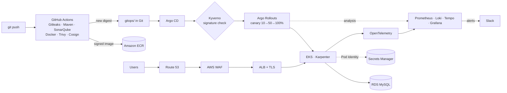

# EKS GitOps Platform

A production-style delivery platform for a Spring Boot API (`dkmwebapp`) on Amazon EKS. A `git push` is
scanned, built, signed and published by GitHub Actions. Argo CD then deploys it from Git, Kyverno checks the
signature, and Argo Rollouts releases it as a canary that rolls itself back if the error rate rises. All of
it is created from Terraform and Git in about 20 minutes, and destroyed again at the end of each session.

Three results, measured on the running platform:

- **A bad release rolls itself back.** A release that failed 30% of requests reached 10% of traffic, and its Prometheus analysis
  aborted it **87 seconds** later. 4 of 106 probe requests failed in that window, none after.
- **Unsigned or unsafe pods can't run.** Five ways to sneak a pod into the app namespace (foreign image, tag
  instead of digest, an image pushed by hand without a CI signature, no resource limits, privileged root
  container) are all rejected at admission. The real, CI-signed app is admitted.
- **Releases and node replacements don't drop requests.** 0 failed out of 371 requests during a rolling
  update, and 952 of 952 while every system node was replaced.

[Live pipeline and architecture →](https://danielkojomegbenu.com/projects/eks-gitops-platform) ·
[Step-by-step build guide →](docs/guide/README.md)

## Architecture



| Folder | What's in it |
|---|---|
| [`app/`](app) | The Spring Boot API, its Flyway migrations and the multi-stage, distroless Dockerfile |
| [`infra/foundation/`](infra/foundation) | Terraform kept permanently: ECR, the GitHub OIDC role for CI, the TLS certificate |
| [`infra/platform/`](infra/platform) | Terraform per session: VPC, EKS, Karpenter, Pod Identity roles, RDS, WAF |
| [`gitops/`](gitops) | Everything Argo CD deploys: add-ons (`platform/`), their config, the app chart and per-environment values |
| [`scripts/`](scripts) | `session-up.sh`, `session-down.sh`, `check-leftovers.sh`, `tf.sh` |
| [`docs/guide/`](docs/guide/README.md) | The 13-phase guide this was built from, kept in sync with the code |
| [`legacy-2024/`](legacy-2024) | The 2024 Jenkins/Ansible version, for comparison |

## What happens on `git push`

From [`.github/workflows/ci.yml`](.github/workflows/ci.yml), about 4.5 minutes:

1. **Gitleaks** scans the whole history for committed secrets.
2. **Maven** runs the tests; **SonarQube Cloud** applies the quality gate.
3. **Docker Buildx** builds the image for amd64 and arm64 (Maven runs once, natively).
4. **Trivy** scans the image (fails on fixable HIGH/CRITICAL vulnerabilities) and the infrastructure code.
5. The image is pushed to **ECR** with OIDC credentials (no stored AWS keys).
6. **Syft** produces an SBOM; **Cosign** signs the image keylessly and attests the SBOM.
7. A bot commit writes the new **digest** to `gitops/envs/prod/values.yaml`.
8. **Slack** gets the result.

Then, in the cluster: **Argo CD** sees the commit and updates the Rollout; **Kyverno** verifies the Cosign
signature against this repository's workflow identity; **Argo Rollouts** sends 10% of traffic to the new
version, then 50%, then 100%, querying **Prometheus** every 30 seconds and aborting if fewer than 95% of the
canary's requests succeed. Argo CD posts the deployment to Slack.

## Security, by layer

| Layer | Control |
|---|---|
| Source | Gitleaks on every push; SonarQube quality gate; Dependabot |
| Build | Trivy image and IaC scans; distroless, non-root image; pinned base and agent checksums |
| Supply chain | Keyless Cosign signatures and SBOM attestations (Sigstore bundles); deploy by digest only |
| Admission | Kyverno: signature verification, registry allow-list, required requests/limits; Pod Security `restricted` |
| Identity | GitHub OIDC for CI; EKS Pod Identity, one IAM role per add-on; IMDS hop limit 1 |
| Secrets | AWS Secrets Manager, synced by External Secrets; nothing secret in Git |
| Edge | ALB with TLS 1.3 policy; AWS WAF managed rules (common, known bad inputs, SQLi, IP reputation) and a per-IP rate limit |

## Results

| Measurement | Result |
|---|---|
| CI pipeline, push to signed image | ~4.5 min |
| Image (compressed, per architecture) | ~140 MB, distroless Java 21 + OpenTelemetry agent |
| Good canary release, 10% → 50% → 100% | ~8.5 min from deploy commit to 100%; 14 of 14 analysis readings passed; 2 of 636 probe requests failed, at the final switch (see below) |
| Bad release (30% errors injected) | Aborted 87 s after reaching 10% (success rate 0.80, then 0.78, against 0.95); 4 of 106 requests failed (3.8%); fix forward with `git revert`: Healthy 7 s after the push |
| Rolling update, Deployment | 0 failed of 371 requests |
| System node replacement | 952 of 952 requests succeeded |
| Admission tests | 5 of 5 attacks rejected, app admitted |
| WAF | SQL injection (2 forms), XSS, path traversal and a Log4Shell header: all 403; normal requests 200 |
| Traces | 87 of 87 traces are real requests after dropping health checks at the collector |
| Platform from nothing | ~20 min (`scripts/session-up.sh`) |
| Cost | ~$0.34/hour while running; under $1/month when torn down |

What didn't go perfectly, and is written up in the guide:

- **Switching the app from a Deployment to a Rollout cost ~38 seconds of 503s** (50 of 516 probe requests).
  The Ingress moved to the new stable/canary target groups before the Rollout's pods were registered in them.
  The safer migration is a Rollout with `workloadRef` pointing at the existing Deployment and
  `scaleDown: progressively`, switching the Ingress only once the Rollout is healthy.
- **2 requests failed at the very end of a good canary** (2 of 636). Promotion points the stable Service at the
  new pods, which must then pass the ALB health check in the stable target group while it still carries 50% of
  traffic. Argo Rollouts' ALB ping-pong mode avoids this; it's the next change.
- **Losing one system node took down the other** (second run). App pods had scaled onto a system node, filled
  its memory and its kubelet stopped; its 22 pods, Argo CD's controller among them, moved to the other system node,
  which then failed the same way. Meanwhile the HPA reached 6 pods, and 6 × Hikari's default pool of 10 is more
  connections than the db.t4g.micro allows, so new pods crash-looped on `Too many connections`. The app kept
  serving from the healthy pods. Recovery was by hand: add a node first, then terminate the dead ones and
  force-delete their pods. The fix is in Git: three system nodes, app pods only on Karpenter nodes, a pool of 5
  per pod, and a slower HPA scale-up.
- **Kyverno's webhook fails closed.** When a system node briefly stopped reporting, Kyverno's single replica
  was rescheduled, and for that minute the cluster couldn't create app pods. In production: three replicas
  and a PodDisruptionBudget.

## Run it yourself

Prerequisites (tools, accounts, budget alarm): [Phase 0](docs/guide/00-prerequisites.md). Then:

```bash
scripts/session-up.sh       # ~20 min: Terraform, Argo CD, then everything syncs from Git
# work …
scripts/session-down.sh     # ~15 min: Kubernetes-created AWS resources first, then Terraform; ends with "All clear"
scripts/check-leftovers.sh  # any time: lists anything billable still running
```

`ENV=dev scripts/session-up.sh` creates a separate environment from `infra/platform/envs/dev.tfvars`.

## Cost

| Resource | Rate |
|---|---|
| EKS control plane | $0.10/h |
| 3 × t3.medium system nodes | ~$0.125/h |
| NAT gateway | ~$0.045/h |
| Application Load Balancer | ~$0.025/h |
| Karpenter spot nodes | ~$0.01–0.03/h |
| RDS db.t4g.micro | ~$0.016/h |
| Public IPv4, EBS, WAF | ~$0.03/h |
| **Total** | **~$0.34/h**, about $2.80 for an 8-hour session |

The platform exists only during work sessions. What stays between sessions (ECR, the certificate, the
Terraform state bucket, two Secrets Manager secrets) costs under $1/month.

## What I'd do differently in production

- **A NAT gateway per AZ** instead of one: an AZ outage would cut egress for the others.
- **RDS Multi-AZ**, deletion protection, final snapshots and RDS-managed password rotation.
- **Separate AWS accounts** for dev, staging and prod, with promotion by pull request in the GitOps repo.
- **A private EKS API endpoint** behind a VPN or SSM, instead of a public endpoint with an IP allow-list.
- **Kyverno with three replicas** and a PodDisruptionBudget, because its webhook fails closed (see above).
- **Bigger system nodes, and HA for the platform.** Three t3.medium nodes carry Argo CD, Kyverno and the
  observability stack at 65–80% memory, each as a single replica; production wants room for a node to fail.
- **Long-term metrics and logs** in S3 (Thanos or Mimir, Loki in S3 mode) instead of 2-day volumes.
- **Terraform in CI**: plan on pull request, apply on merge, with cost estimates on the PR.
- **CloudFront in front** if the service served static assets or global users.
- **A least-privilege database user** for the app instead of the master user.
