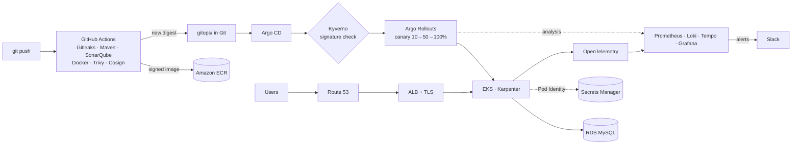

# EKS GitOps Platform: Build Guide

A step-by-step guide to building the platform shown on
[danielkojomegbenu.com/projects/eks-gitops-platform](https://danielkojomegbenu.com/projects/eks-gitops-platform):
a Java service that goes from `git push` to production on Amazon EKS through a scanned, signed,
GitOps-delivered, canary-released pipeline, with full observability.

Work through the phases **in order**. Each phase ends with a **✅ Checkpoint**: don't start the next
phase until every check in it passes.

---

## What you'll have at the end

## The phases

| # | Phase | You'll have | Time | Cost while it runs |
|---|---|---|---|---|
| 0 | [Prerequisites and cost plan](00-prerequisites.md) | Tools, accounts, budget, `remodelled` branch | 1–2 h | $0 |
| 1 | [Repository and sample app](01-repo-and-app.md) | `dkmwebapp` running locally in Docker | 2–3 h | $0 |
| 2 | [Terraform foundation](02-terraform-foundation.md) | ECR, CI role, HTTPS certificate | 1 h | ~$0 (kept permanently) |
| 3 | [EKS cluster](03-eks-cluster.md) | VPC, EKS, nodes, Karpenter and Pod Identity roles | 2 h | **~$0.25/h** |
| 4 | [GitOps bootstrap and add-ons](04-gitops-bootstrap.md) | Argo CD installing every add-on from Git | 2 h | ~$0.25/h |
| 5 | [Database and secrets](05-database-and-secrets.md) | RDS MySQL, password synced by External Secrets | 1–2 h | +$0.02/h |
| 6 | [CI pipeline](06-ci-pipeline.md) | Scan → build → sign → push → bump digest | 2–3 h | $0 (GitHub-hosted) |
| 7 | [Deploy the app](07-deploy-app.md) | `https://app.danielkojomegbenu.com` live | 2 h | +$0.03/h (ALB) |
| 8 | [Observability](08-observability.md) | Prometheus, Loki, Tempo, Grafana, Slack alerts | 2–3 h | +$0.01/h |
| 9 | [Policies with Kyverno](09-policies.md) | Unsigned or unsafe pods are rejected | 1–2 h | $0 |
| 10 | [Canary releases](10-canary-releases.md) | Automatic rollback of a bad release | 2 h | $0 |
| 11 | [Optional: Web Application Firewall](11-edge-optional.md) | AWS WAF on the ALB: managed rules, rate limiting | 1 h | ~$0.01/h (prorated) |
| 12 | [Portfolio, documentation and teardown](12-portfolio-and-teardown.md) | Live pipeline on your portfolio, clean shutdown | 2 h | $0 after teardown |

Times assume you know the tools; add time for reading docs and debugging.

---

## Read this first: how the money works

Nothing in this project is free while the cluster runs. These are **us-east-1 on-demand prices**;
check the [AWS pricing pages](https://aws.amazon.com/pricing/) if you want exact numbers for today.

| Resource | Rate | Per 8-hour session | If you forget for a month |
|---|---|---|---|
| EKS control plane | $0.10/h | $0.80 | $73 |
| NAT gateway (+ data) | ~$0.045/h | $0.36 | $33 |
| 3 × t3.medium system nodes | ~$0.125/h | $1.00 | $91 |
| Karpenter spot nodes (1–2 small) | ~$0.01–0.03/h | $0.15 | $20 |
| Application Load Balancer | ~$0.025/h | $0.20 | $18 |
| RDS db.t4g.micro (single-AZ) | ~$0.016/h | $0.13 | $12 |
| Public IPv4 addresses (NAT, ALB) | $0.005/h each | $0.12 | $11 |
| EBS volumes (Prometheus, Loki) | ~$0.10/GB-month | ~$0 | $4 |
| **Total** | **~$0.34/h** | **~$2.80** | **~$260** |

**So the rule for the whole project is: build in sessions, destroy at the end of every session.**
The infrastructure is split so that's painless:

- **`infra/foundation`** (ECR, CI role, ACM certificate) costs pennies and **stays up**.
- **`infra/platform`** (VPC, EKS, nodes, RDS) is **created when you sit down and destroyed when you stand up**.
  Phase 12 has the exact teardown order, and every phase ends with an "End of session" box.

Before Phase 3 you'll raise your AWS Budgets alert so it tells you if a session was left running.

---

## Conventions used in every phase

- **Commands** are for **Git Bash** on your Windows PC, run from the repo root unless a `cd` says otherwise.
  PowerShell differences are noted where they matter.
- `‹placeholder›` means "replace with your value". Everything else is literal.
- **💰** marks a step that starts something billable.
- **⚠️** marks a step where getting it wrong costs time or money.
- **✅ Checkpoint** lists the exact commands and the output you should see.
- **Commit** blocks tell you when to commit, so your Git history tells the story of the build. That history is
  part of the portfolio.

## Versions

Everything is pinned. Where a version number appears, it was current when this guide was written
(November 2026). If a newer one exists when you start, you can use it, but **pin it**, don't use `latest`, and
expect to adjust an argument name now and then. The guide shows the command to look up the latest version
each time.
